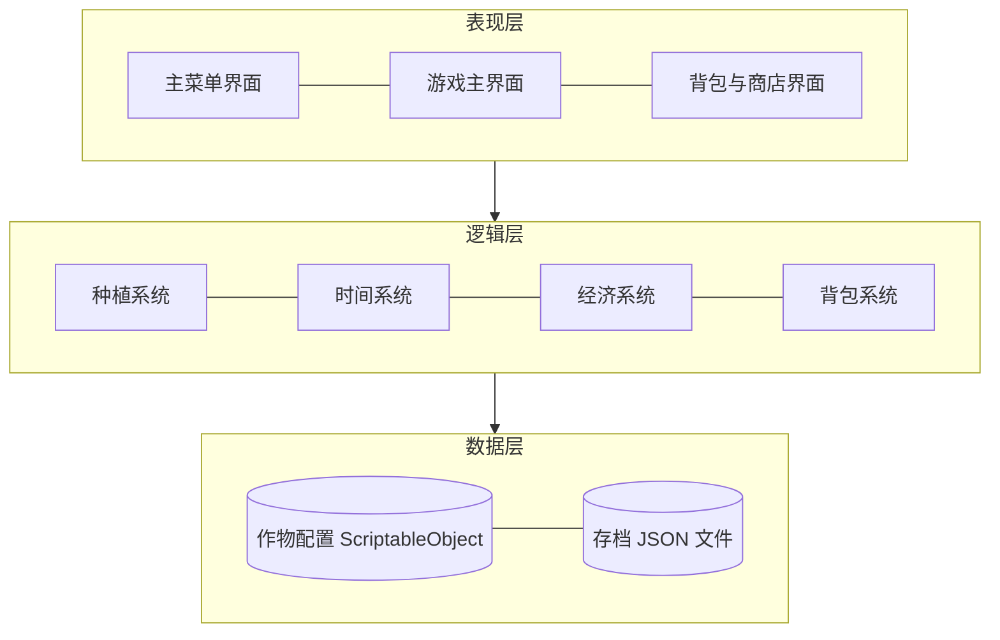
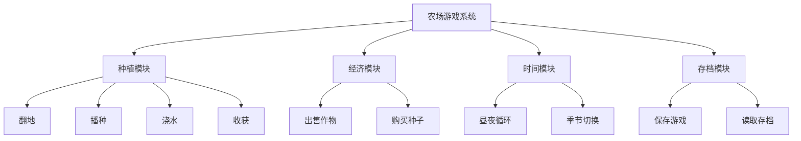
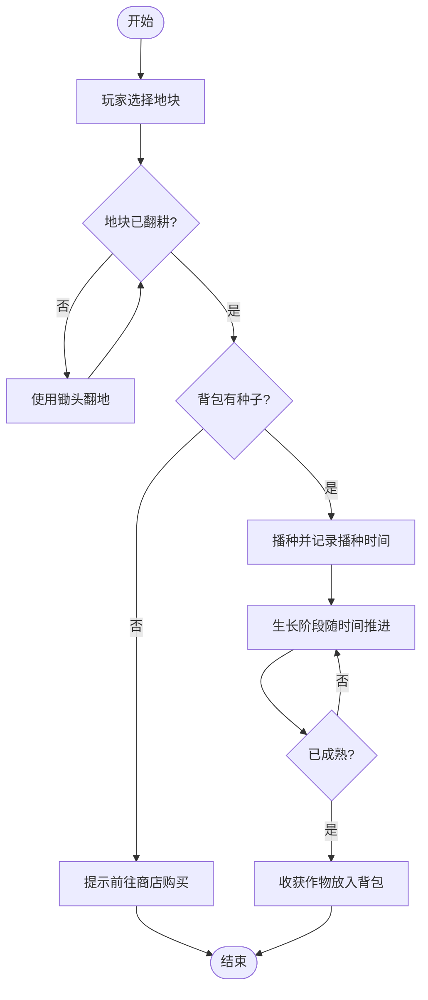
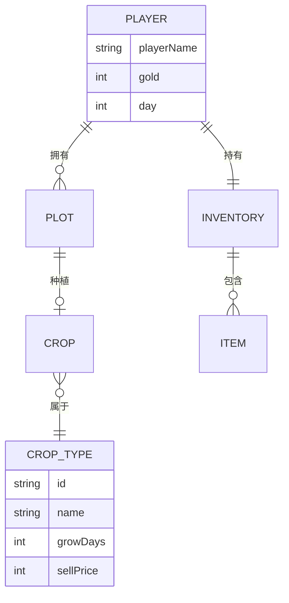
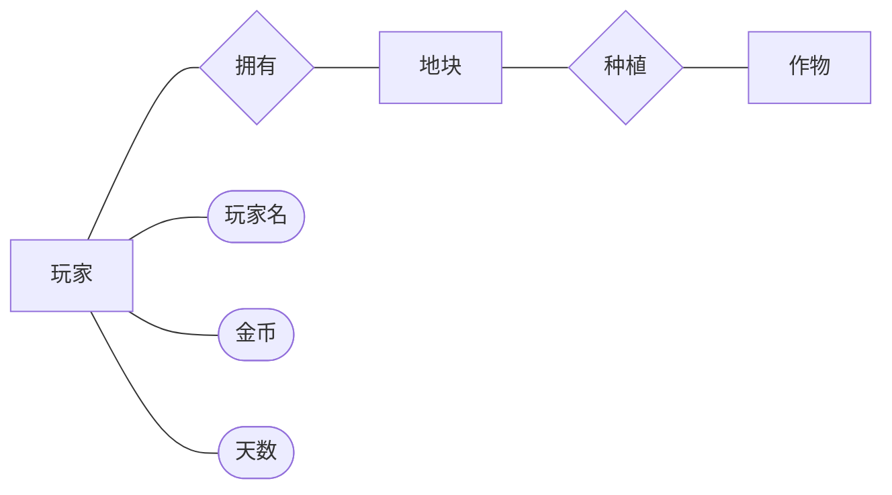
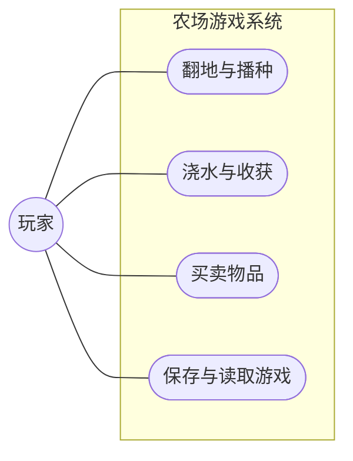
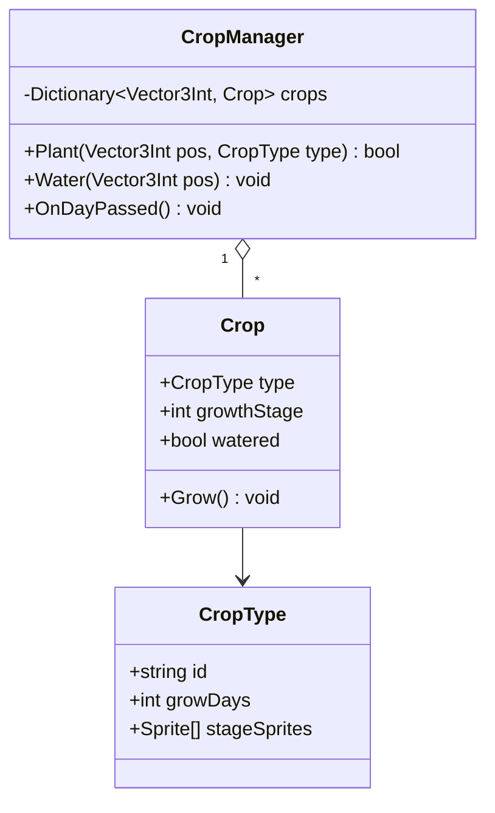
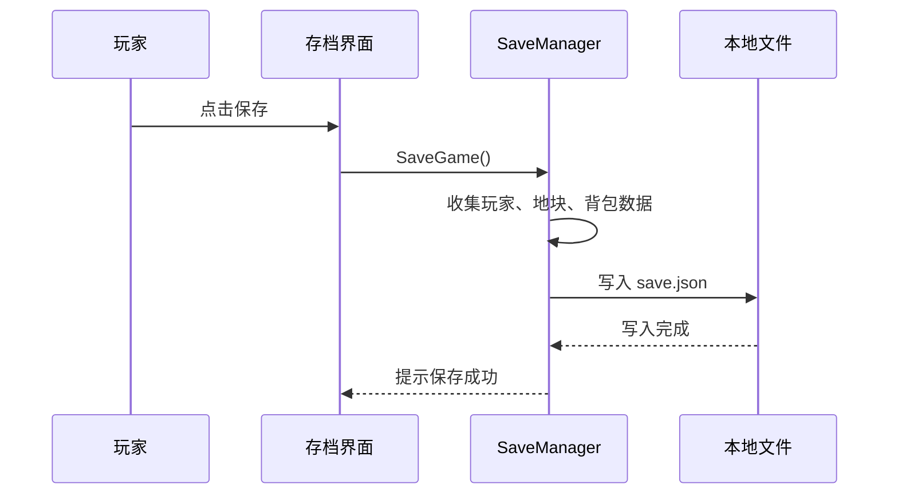
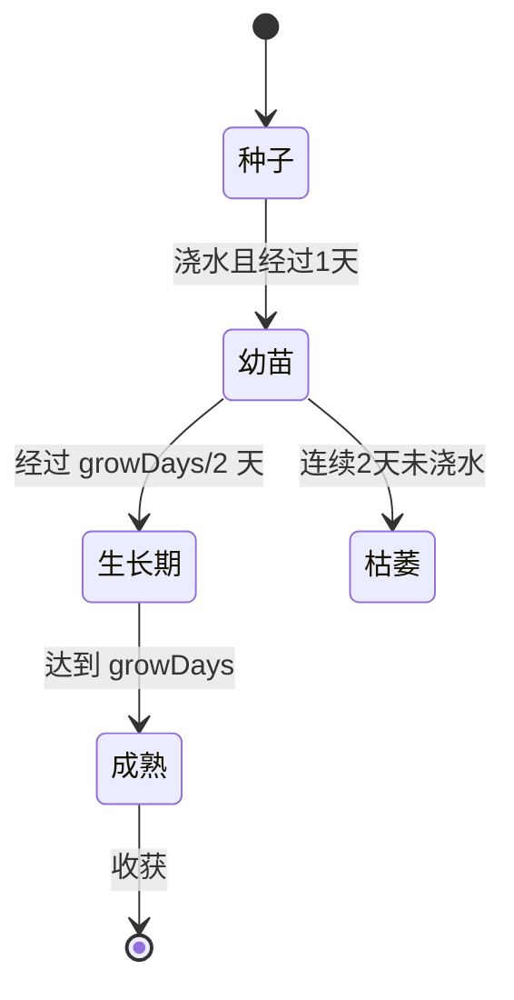

# 论文常用图的 Mermaid 模板

文件放在 `figures/src/<文件名>.mmd`，渲染后得到 `figures/<文件名>.png`。文件名用英文或拼音，图题写在正文的图片标记里。下面示例以农场游戏为例，替换成项目里真实存在的模块。

## 1. 系统总体架构图（分层）

## 2. 功能模块图（树状）

叶子节点超过 15 个时，按一级模块拆成多张图。

## 3. 业务流程图

开始/结束用 `([ ])`，判断用 `{ }`，处理用 `[ ]`。

## 4. E-R 图

Mermaid 的 E-R 图是鸦脚标记法，不是陈氏（菱形）E-R 图。学校明确要求陈氏画法时，把 `.mmd` 当作草稿，提醒用户用 draw.io / ProcessOn 重画，或改用下面的 flowchart 近似画法：

## 5. 用例图（近似画法）

Mermaid 没有标准 UML 用例图，用 flowchart 近似：

## 6. 类图

类名、字段、方法必须和项目代码一致，只画核心类。

## 7. 时序图

## 8. 状态图

## 渲染效果问题

| 问题 | 处理 |
|---|---|
| 图太宽，缩到页面后字太小 | 改 `flowchart TB`，或 `subgraph` 里用 `direction TB` |
| 连线交叉多 | 调整节点声明顺序，或拆图 |
| 中文显示成方块 | 确认系统有宋体/黑体，或在 `mermaid.json` 里改字体 |
| 节点文字含括号、冒号报错 | 用引号包住：`a["存档(JSON)"]` |
